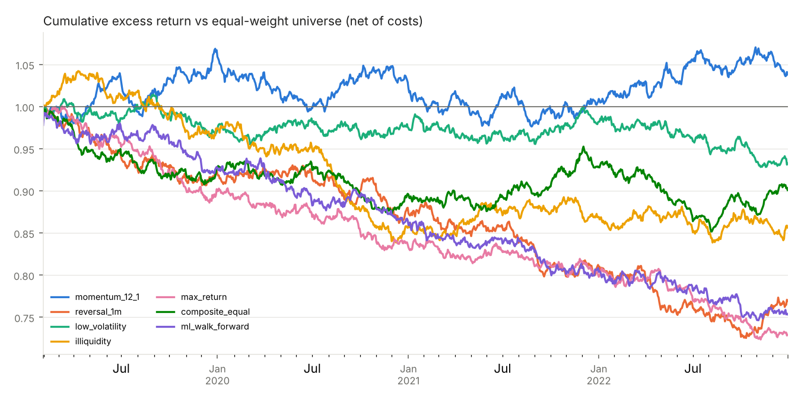
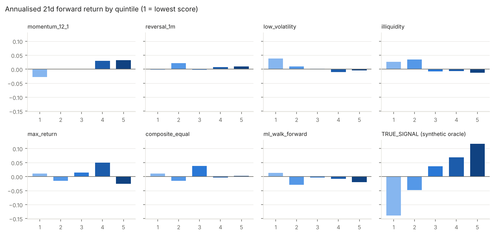
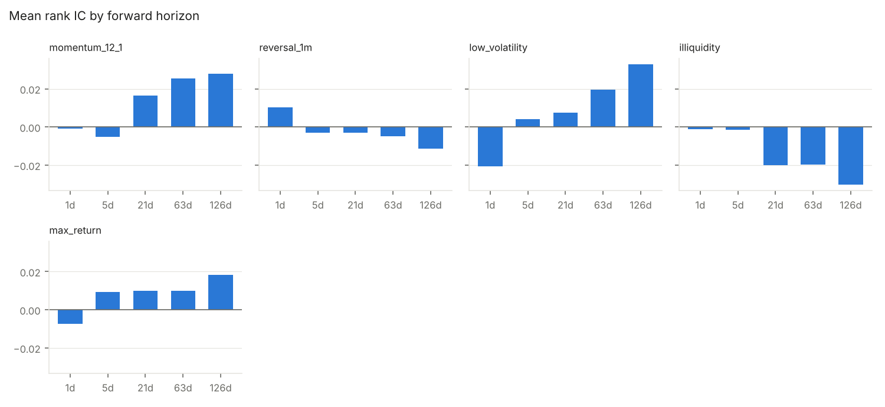

# Synthetic market (planted signal) -- engine validation

- Research window: 2019-01-31 to 2022-12-31 (72 monthly IC dates; metrics use the window where all strategies are live)
- **Holdout: 2023-01-01 to 2025-03-14** (27 rebalances) -- excluded from every table except section 7
- Universe: point-in-time investable filter, median 251 stocks per rebalance
- Portfolio: long-only, top 20% by signal, equal weight, monthly; signal at close d, trade at close d+1
- Costs: buy 0.1925%, sell 0.4925% (commission x1.0, 0.3% tax, slippage 0.05%/side)
- Benchmark (equal-weight universe): CAGR -1.0%, Sharpe 0.02
- DSR computed over 7 trials (every strategy in the table except the oracle). It only counts what is in this run: every earlier variant you tried is also a trial.

## 1. Predictive power (rank IC, 21-day forward, monthly samples)

| signal | ic_mean | ic_std | icir_ann | t_stat_nw | hit_rate | n_periods | q5_q1_ann | q5_q1_t_nw |
|---|---|---|---|---|---|---|---|---|
| momentum_12_1 | 0.016 | 0.075 | 0.760 | 2.499 | 58.3% | 72 | 6.1% | 2.349 |
| reversal_1m | -0.003 | 0.072 | -0.141 | -0.424 | 48.6% | 72 | 1.2% | 0.388 |
| low_volatility | 0.008 | 0.063 | 0.418 | 1.084 | 56.9% | 72 | -4.2% | -1.653 |
| illiquidity | -0.020 | 0.061 | -1.131 | -2.688 | 40.3% | 72 | -3.9% | -1.393 |
| max_return | 0.010 | 0.062 | 0.559 | 1.649 | 54.2% | 72 | -3.6% | -1.293 |
| composite_equal | 0.006 | 0.071 | 0.299 | 0.853 | 51.4% | 72 | -0.9% | -0.255 |
| ml_walk_forward | -0.005 | 0.061 | -0.288 | -0.597 | 48.9% | 47 | -3.2% | -1.135 |
| TRUE_SIGNAL (synthetic oracle) | 0.079 | 0.058 | 4.705 | 11.221 | 91.7% | 72 | 25.6% | 8.698 |

`q5_q1_*` = mean forward return of the top minus the bottom quintile. When rank IC is significant but this is not, the 'effect' is likely volatility drag on medians, not returns.

## 2. Backtest (net of costs)

| strategy | net_cagr | net_sharpe | max_dd | gross_excess_ann | excess_ann | excess_sharpe | ann_turnover | ann_cost | DSR | blocked_trades | delisted_exits |
|---|---|---|---|---|---|---|---|---|---|---|---|
| momentum_12_1 | -0.1% | 0.081 | -38.7% | 3.2% | 0.9% | 0.222 | 3.3x | 2.2% | 0.073 | 1 | 3 |
| reversal_1m | -7.2% | -0.334 | -43.9% | -0.0% | -6.3% | -1.262 | 9.4x | 6.4% | 0.000 | 1 | 1 |
| low_volatility | -2.4% | -0.079 | -34.2% | 0.0% | -1.7% | -0.426 | 2.6x | 1.7% | 0.003 | 0 | 3 |
| illiquidity | -4.8% | -0.186 | -41.3% | -1.8% | -3.8% | -0.789 | 2.9x | 2.0% | 0.000 | 0 | 4 |
| max_return | -8.2% | -0.454 | -41.7% | -2.6% | -7.5% | -1.812 | 7.5x | 5.1% | 0.000 | 0 | 2 |
| composite_equal | -3.4% | -0.125 | -37.5% | 2.2% | -2.5% | -0.599 | 6.8x | 4.7% | 0.001 | 0 | 1 |
| ml_walk_forward | -7.6% | -0.371 | -42.2% | -1.3% | -6.7% | -1.390 | 8.4x | 5.7% | 0.000 | 0 | 6 |
| TRUE_SIGNAL (synthetic oracle) | 9.7% | 0.623 | -28.2% | 13.5% | 10.7% | 2.311 | 3.5x | 2.4% | nan | 0 | 2 |

`gross_excess_ann` is before costs and `excess_ann` after; the gap is what trading costs take.

## 3. Excess return by calendar year

| strategy | 2019 | 2020 | 2021 | 2022 |
|---|---|---|---|---|
| momentum_12_1 | 6.7% | -3.6% | -2.3% | 3.2% |
| reversal_1m | -7.6% | -4.8% | -7.7% | -5.3% |
| low_volatility | -3.0% | 0.5% | 0.6% | -5.0% |
| illiquidity | -2.6% | -12.1% | 1.5% | -1.5% |
| max_return | -9.8% | -7.3% | -4.3% | -8.9% |
| composite_equal | -7.2% | -3.4% | 3.5% | -2.9% |
| ml_walk_forward | -7.2% | -6.8% | -6.5% | -6.8% |
| TRUE_SIGNAL (synthetic oracle) | 18.8% | 3.7% | 4.8% | 17.1% |

## 4. Quintile monotonicity

## 5. IC decay

| horizon_days | momentum_12_1 | reversal_1m | low_volatility | illiquidity | max_return |
|---|---|---|---|---|---|
| 1 | -0.001 | 0.010 | -0.021 | -0.001 | -0.007 |
| 5 | -0.005 | -0.003 | 0.004 | -0.001 | 0.009 |
| 21 | 0.016 | -0.003 | 0.008 | -0.020 | 0.010 |
| 63 | 0.026 | -0.005 | 0.019 | -0.020 | 0.010 |
| 126 | 0.028 | -0.011 | 0.033 | -0.030 | 0.018 |

## 6. Factor correlation (average cross-sectional rank correlation)

|  | momentum_12_1 | reversal_1m | low_volatility | illiquidity | max_return |
|---|---|---|---|---|---|
| momentum_12_1 | 1.000 | -0.016 | 0.022 | -0.267 | 0.008 |
| reversal_1m | -0.016 | 1.000 | -0.008 | 0.056 | 0.293 |
| low_volatility | 0.022 | -0.008 | 1.000 | -0.241 | 0.647 |
| illiquidity | -0.267 | 0.056 | -0.241 | 1.000 | -0.173 |
| max_return | 0.008 | 0.293 | 0.647 | -0.173 | 1.000 |

## 7. Holdout (out-of-sample, not used for any decision above)

| strategy | ic_mean | net_cagr | net_sharpe | max_dd | gross_excess_ann | excess_ann | excess_sharpe | ann_turnover | ann_cost | blocked_trades | delisted_exits |
|---|---|---|---|---|---|---|---|---|---|---|---|
| momentum_12_1 | 0.007 | -9.0% | -0.507 | -33.0% | 2.6% | 0.3% | 0.090 | 3.3x | 2.2% | 1 | 0 |
| reversal_1m | -0.013 | -15.4% | -0.925 | -40.6% | -0.3% | -6.6% | -1.254 | 9.5x | 6.5% | 0 | 2 |
| low_volatility | 0.036 | -7.1% | -0.443 | -29.5% | 4.1% | 2.2% | 0.568 | 2.6x | 1.8% | 0 | 2 |
| illiquidity | -0.030 | -16.3% | -0.965 | -42.4% | -5.6% | -7.6% | -1.600 | 3.2x | 2.2% | 0 | 4 |
| max_return | 0.026 | -12.7% | -0.842 | -37.8% | 1.4% | -3.9% | -0.844 | 7.9x | 5.4% | 0 | 2 |
| composite_equal | 0.015 | -15.2% | -0.999 | -40.1% | -2.0% | -6.5% | -1.550 | 6.9x | 4.7% | 0 | 0 |
| ml_walk_forward | -0.010 | -13.6% | -0.831 | -37.8% | 1.0% | -4.8% | -1.029 | 8.6x | 5.9% | 1 | 2 |
| TRUE_SIGNAL (synthetic oracle) | 0.079 | 3.5% | 0.290 | -21.4% | 17.1% | 14.1% | 2.729 | 3.7x | 2.6% | 0 | 0 |

Read this once. If you change a factor or parameter after seeing it, the holdout
is no longer out-of-sample.
